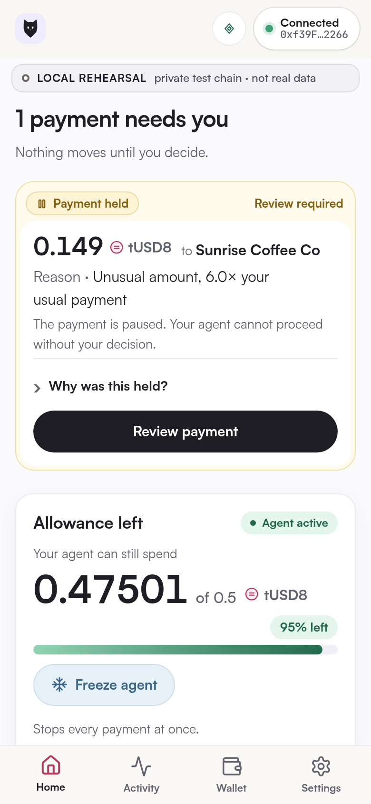
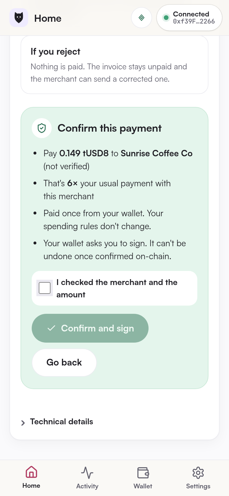
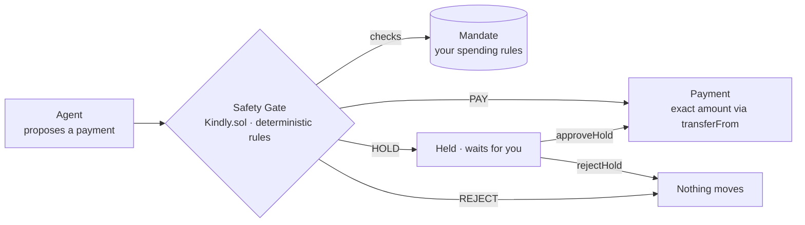
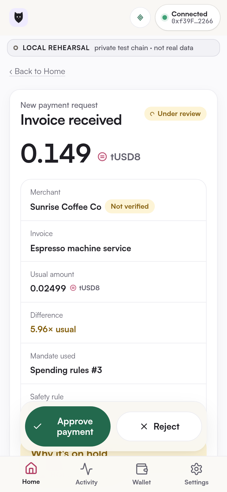
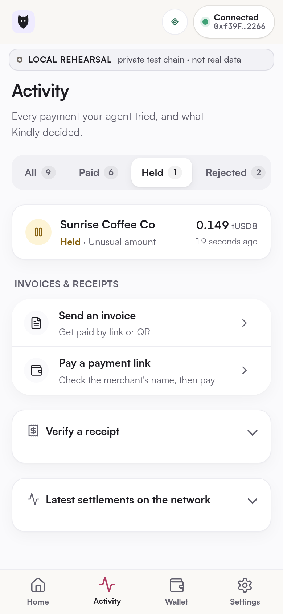
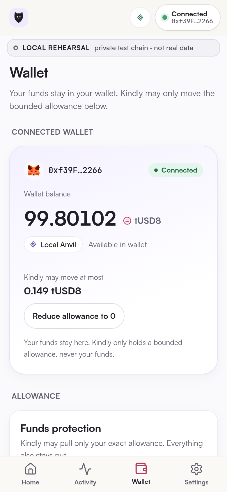
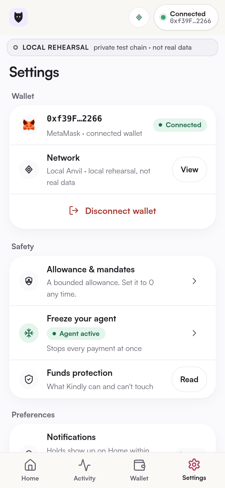
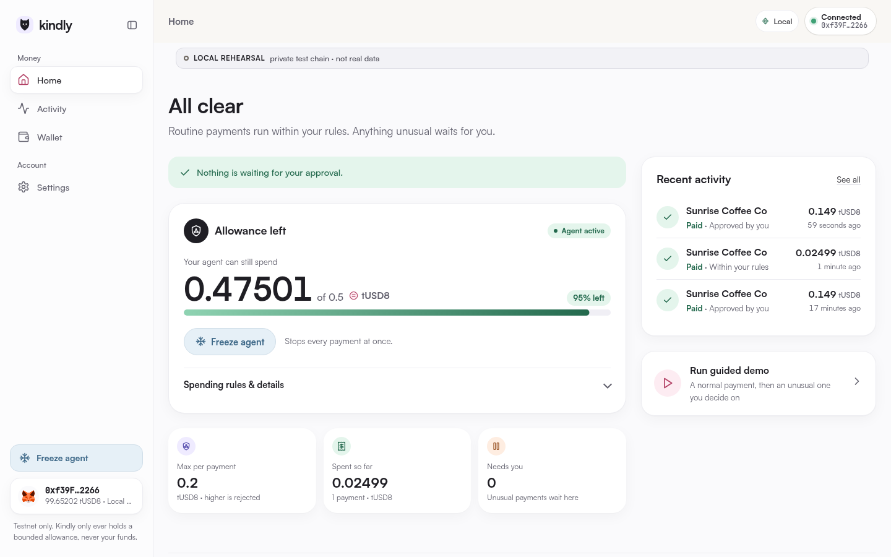
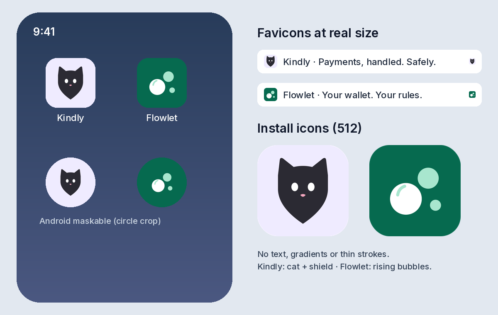
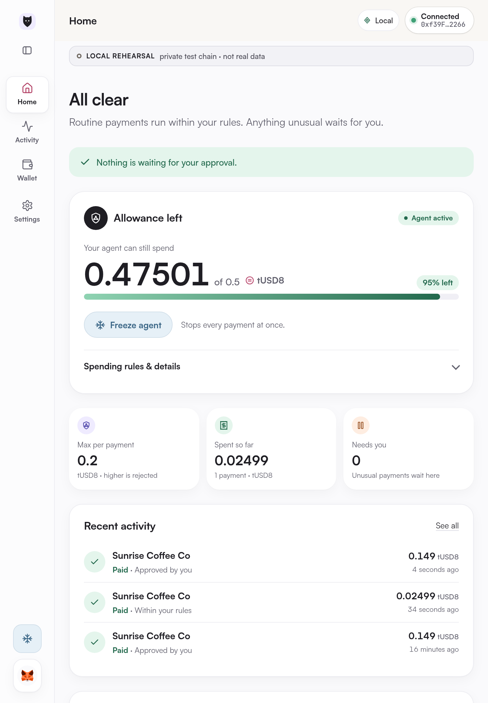

# Kindly

> **AI should be able to pay for you — but it should never have unlimited permission to spend your money.**

Kindly is a spending-rules layer for payment agents on **QDay Aevum Testnet** (chain `44005`, test stablecoin **tUSD8**). You give an agent a **bounded allowance** and a set of spending rules (max per payment, total budget, usual payment, allowed merchants, expiry). Every payment the agent attempts goes through an **on-chain Safety Gate** that returns **PAY**, **HOLD** or **REJECT** with a reason code. A HOLD waits for *your* signature. Funds stay in your wallet outside the allowance.

The gate is a set of **fixed, deterministic contract rules**, not an AI model. The same invoice always gets the same verdict, and anyone can re-check it from the event log. The agent in this repo (`agent/agent.mjs`) is a small scripted stand-in for an AI agent; the plain-English explanations are templates.

**Live app:** [https://kindly-lemon.vercel.app](https://kindly-lemon.vercel.app) · no sign-up, no email, no password: just a wallet, or no wallet at all for the demo.

| | |
|---|---|
|  |  |

**Demo video:** [docs/video/kindly-demo.mp4](docs/video/kindly-demo.mp4) (2:02, English voiceover and captions, recorded from the live site in no-wallet replay mode).

Design system: [docs/DESIGN_NOTES.md](docs/DESIGN_NOTES.md) · Security, custody & privacy: [docs/SECURITY.md](docs/SECURITY.md) · Pitch: [docs/PITCH.md](docs/PITCH.md)

## How it works



## Three ways in

The entry screen offers three paths, and a badge at the top of every screen says which mode you are in:

| Path | What happens | Mode badge |
|---|---|---|
| **Connect wallet · Try live** | MetaMask on Aevum Testnet. Real transactions, real gas (tQDAY). | `LIVE TESTNET` (warns if you are on the wrong network) |
| **Explore demo without wallet** | A guided replay of a real recorded run on Aevum. Every link opens a real transaction; nothing is sent. | `DEMO MODE` |
| **Watch the 2-minute walkthrough** | The in-app link opens the recorded demo video ([docs/video/kindly-demo.mp4](docs/video/kindly-demo.mp4)). The written [60-second demo](#60-second-demo) is below. | |

On a local Anvil chain the badge reads `LOCAL REHEARSAL · private test chain · not real data`, so screenshots from a rehearsal can't be mistaken for testnet data.

## 60-second demo

1. **0:00 · Open** [kindly-lemon.vercel.app](https://kindly-lemon.vercel.app) and choose **Explore demo without wallet** (or Settings → Guided demo). The badge says `DEMO MODE`.
2. **0:10 · Rules.** "Your agent's spending rules": max $200 per payment, $500 budget, usual payment $25, one allowed café. Funds stay in your wallet outside the allowance.
3. **0:20 · Scenario 1.** The agent pays a normal $24.99 invoice. The gate returns **PAY** (`Ok`); the transaction link opens on the Aevum explorer.
4. **0:30 · Scenario 2.** The agent tries $149 at the same café. The gate returns **HOLD** (`AmountAnomaly`, 6.0× the usual payment; holds start at 3×). The amber card says: *The payment is paused. Your agent cannot proceed without your decision.* Open **Why was this held?** to see the values the rule used.
5. **0:40 · You decide.** Tap **Approve** (the payment settles, the allowance drops) or **Reject** (nothing is paid).
6. **0:50 · Proof.** The proof table lists every transaction of the run. With a wallet connected, switch to **Live on testnet** and the same two scenarios run for real with a fresh throwaway café (about 5 confirmations, 0.17399 tUSD8 that is refunded at the end).

## Proof: the recorded guided-demo run on Aevum

Recorded by `npm run judge` (`scripts/judge.mjs`) on 2026-11-19 against the deployed contracts; full record in [deployments/judge-44005.json](deployments/judge-44005.json). Amounts are scaled 1:1000 (see [Scale note](#scale-note)).

| Step | Result | Transaction |
|---|---|---|
| Café registers its name, attester verifies it | verified payee | [`0x87fa6f11…`](https://explorer-test.qday.info/tx/0x87fa6f1109c90d95e3684984dca7c10aab4e340eaf434365294717424cb9a7cb) · [`0xba23ecc2…`](https://explorer-test.qday.info/tx/0xba23ecc22dfc4019880a6745488e236cf9d93d88514a4db7cf662c8cd8456247) |
| Payer allows exactly 0.32299 tUSD8 (bounded allowance) | allowance set | [`0x2a84d999…`](https://explorer-test.qday.info/tx/0x2a84d9994d2a0a9cb0c8c346fa494615e852e0473f3d63c9ff1011befe4e9066) |
| Payer sets the spending rules (mandate #3) | rules active | [`0x86291c2e…`](https://explorer-test.qday.info/tx/0x86291c2e2b91ed9cd501d64e98471f8ad19b92c989fdc54c4daac445a60e24d4) |
| Agent → gate: INV-J1 $24.99 | **PAY** · `Ok` | [`0xc81f404b…`](https://explorer-test.qday.info/tx/0xc81f404b6e98df6319732a5e59d9df6a29132cc03bab5e29c63419e0220f61b7) |
| Agent → gate: INV-J3 $149 | **HOLD** · `AmountAnomaly` | [`0x4ebd6479…`](https://explorer-test.qday.info/tx/0x4ebd64792432457b727aa9f81f3fff57ffeafe57bb7e1ab4249914f064f06a6e) |
| Owner rejects INV-J3 | nothing paid | [`0x72d35493…`](https://explorer-test.qday.info/tx/0x72d354931a159cc549cdf6fb679b69d29127e045c0bea30ec99c14ffb769fb03) |
| Agent → gate: INV-J2 $149 | **HOLD** · `AmountAnomaly` | [`0x67774622…`](https://explorer-test.qday.info/tx/0x67774622cce850b23fd3132e119582967e0428fec1b76e4c1cbacb1e74b08b51) |
| Owner approves INV-J2 | paid, allowance 0.298 → 0.149 | [`0x8ae0f976…`](https://explorer-test.qday.info/tx/0x8ae0f97602756c3b0c76bfde9744be8cc2b7f899dce11dbd473f24680868781f) |
| Cleanup: refunds, cancel INV-J3, revoke mandate, allowance back to 0 | balances restored | [`0xadd1e11f…`](https://explorer-test.qday.info/tx/0xadd1e11fc84d836709efa50e117b3115b591772ff1b12ec4c551beee13342451) · [`0x1a07cd2c…`](https://explorer-test.qday.info/tx/0x1a07cd2c5e9b33577a61404d541c0ac0336de4cd97dc388825569cf588be3005) · [`0x5a22225e…`](https://explorer-test.qday.info/tx/0x5a22225e7303369854ee629b78eaa4cb3990958207d67ed8dfa3d153db173b59) · [`0x9ef20b36…`](https://explorer-test.qday.info/tx/0x9ef20b3634434970e1b2cf8e187b1454076a1b5330dbcd25768fe006960a9b9d) |

The guided demo's replay mode plays back exactly these transactions (`web/src/judge-runs.json`).

## The problem

AI agents are starting to pay bills. The two most common ways small businesses lose money on invoices are exactly the ones an unsupervised agent would make worse:

- **Invoice fraud and payee swaps.** Someone sends a look-alike invoice ("Sunrise Cofee Co") or swaps the address in a payment link.
- **Duplicates and anomalies.** The same invoice gets paid twice, or a bill is suddenly 6× the usual.

Hard spending limits alone don't fix this. A $149 fake invoice sits well under a $200 cap. An agent wallet also needs rules that are **deterministic, auditable and enforced by the contract**, plus a human in the loop for anything odd.

## What Kindly does

| | |
|---|---|
| **Safety Gate** | `agentProcess()` evaluates each invoice on-chain and emits `SafetyDecision(decision, reason, risk, amount, usualAmount)`. PAY settles immediately. HOLD parks the invoice until **you** sign `approveHold` (or `rejectHold`). REJECT moves nothing. |
| **Spending rules (mandate)** | Max per payment, total budget, usual payment, allowed merchants, expiry and cooldown. Freeze or revoke the agent in one tap. |
| **Guided demo** | Scenario 1 pays automatically, Scenario 2 is held and you approve or reject it, then the proof. Live with a wallet, or a labelled replay of recorded transactions without one. |
| **Links, QR and Confirmation of Payee** | Merchants register a name and an attester verifies it. The contract re-checks the name hash and the maximum amount, so a swapped link or a renamed merchant can't take the payment. |
| **Receipts and refunds** | Every payment gets a receipt hash you can verify on the Receipts page. Merchants can refund fully or partially. |

### Safety Gate rules

The gate checks rules in this order and returns the first match. The thresholds are constants in `Kindly.sol`, so they are the same for everyone and easy to audit.

| Check | Decision | Reason code | Risk |
|---|---|---|---|
| Invoice number already paid to this merchant | REJECT | `Duplicate` | 95 |
| Invoice is not open (cancelled, refunded) | REJECT | `NotOpen` | 100 |
| Invoice expired | REJECT | `Expired` | 90 |
| Merchant not on the mandate's allowlist | REJECT | `MerchantNotAllowed` | 90 |
| Invoice addressed to a different payer | REJECT | `PayerNotAllowed` | 90 |
| Amount above the per-payment cap | REJECT | `OverCap` | 90 |
| Amount above the remaining budget | REJECT | `OverBudget` | 80 |
| Payee name doesn't match what the assistant expects (Confirmation of Payee) | HOLD | `PayeeMismatch` | 85 |
| Payee not verified, and the mandate requires verified payees | HOLD | `PayeeUnverified` | 60 |
| Amount ≥ **3×** the usual amount for this merchant | HOLD | `AmountAnomaly` | 50 + 5×ratio (max 95) |
| None of the above | PAY | `Ok` | ≤ 45, scaled by amount ÷ usual |

The **usual amount** is the average this payer has paid this merchant. Before there is any history, it falls back to the `typicalAmount` baseline you set on the mandate.

Duplicates are tracked per *(payer, merchant, invoice number)*. A merchant can re-issue the same invoice number, which is how the duplicate demo works, but nobody can pay it twice. That holds through the assistant, through a held-then-approved payment, and through a direct payment.

**Kindly also rejects transactions, with no state change, when:**
- the caller isn't the mandate's assistant,
- the mandate is frozen, revoked or expired,
- the mandate is in cooldown,
- the invoice is already on hold, or
- the contract is paused.

### Who decides what

- **The contract decides.** `evaluate()` is a free `view` call, so the UI and the agent can preview a decision. `agentProcess()` makes the binding decision and emits it. These are fixed rules; no AI model is involved.
- **You approve holds.** Only the mandate owner can call `approveHold` or `rejectHold`. Approval re-checks duplicates and the payee name. An approved hold is the owner's own payment, so it doesn't use up the agent's budget. A rejected hold changes nothing.
- **Explanations are templates.** `explainDecision()` in `shared/kindly.js` turns `(decision, reason, risk, amount, usual)` into one sentence. It has no keys and no say. Invoice memos are treated as untrusted text: they're sanitized, shown, and never interpreted. In the e2e run, INV-1003 carries an injection attempt in its memo and is still rejected as `OverCap`.

## Deployed on Aevum Testnet

| Contract | Address | Deploy tx |
|---|---|---|
| **Kindly** | [`0x944e66ba2642a2e83453e62bb48906f22eecb1b3`](https://explorer-test.qday.info/address/0x944e66ba2642a2e83453e62bb48906f22eecb1b3) | [`0x760d8c89…`](https://explorer-test.qday.info/tx/0x760d8c89a19afa97b4062a23bc928a02d087f1e29154ba0db6749c2d8ba5efb6) |
| **PayeeRegistry** | [`0xff6ce066fa19b68bd3150b8a2f0eff477fad2679`](https://explorer-test.qday.info/address/0xff6ce066fa19b68bd3150b8a2f0eff477fad2679) | [`0x0c88ed18…`](https://explorer-test.qday.info/tx/0x0c88ed18075ae3c194d94a4dcd40291d49be77f5933211e6dea38abb9c7a2107) |
| tUSD8 (official test stablecoin, 6 decimals) | [`0x456569838f1d43009A91ebA4263147Afd7233483`](https://explorer-test.qday.info/address/0x456569838f1d43009A91ebA4263147Afd7233483) | n/a |

Deployer/operator `0xD7d365901a2267B860e54E1DfBD3deAd39D39858`, deploy block 3499952. Earlier deployments under previous working names are listed, marked superseded, in [deployments/HISTORY.md](deployments/HISTORY.md).

### Scale note

The deployer had a one-time faucet claim (1 tQDAY, 5 tUSD8), so on-chain amounts are scaled **1:1000**: "$24.99" is `0.02499 tUSD8`. The e2e run and RUN DEMO refund every payment at the end, so token balances go back to their starting values. After this run, the payer, merchant and agent hold exactly what they held before (2, 3 and 0 tUSD8). Only gas was spent.

### Safety Gate decisions (real `SafetyDecision` events, 2026-11-18 14:57 UTC)

| Invoice | Decision | Reason | Risk | Decision tx |
|---|---|---|---|---|
| INV-1001 · $24.99 · usual amount | **PAY** | `Ok` | 19 | [`0x98784b2c…`](https://explorer-test.qday.info/tx/0x98784b2c6080f9aa7fbaa74c845c5baef6a8ff75997484fea355afb8ce824253) |
| INV-1002 · $149 · 6× usual | **HOLD** | `AmountAnomaly` | 75 | [`0xd37ef58d…`](https://explorer-test.qday.info/tx/0xd37ef58d52344b5d63b750f9197ae6095b28862f52581dbb8ac209a2d9495e6d) |
| INV-1001 re-sent · $24.99 | **REJECT** | `Duplicate` | 95 | [`0x94fad52a…`](https://explorer-test.qday.info/tx/0x94fad52aba092367e889dd6218a8ba81339db262a07a1e6f792c45d369c98f20) |
| INV-1003 · $250 · memo contains a prompt-injection attempt | **REJECT** | `OverCap` | 90 | [`0x1fd9c849…`](https://explorer-test.qday.info/tx/0x1fd9c849a8ffada28afe16a5e47e61520e477700fac0f52e0363d778950985b1) |

### Full end-to-end run (`npm run e2e`)

25 transactions, all with status `success`. Each was checked with `cast receipt <hash> status`. The 5 "blocked" rows are attacks the contract refused: the call was simulated, it reverted with the named error, and no transaction was sent. The full machine-readable log is in [deployments/e2e-44005.json](deployments/e2e-44005.json).

| # | Step | Result |
|---|---|---|
| 1 | merchant registers payee name | [`0x7ea48dea…`](https://explorer-test.qday.info/tx/0x7ea48deaf1b9c1e3d65e7e7ff84a3e6f20fa8b8d4e7599ed78a59901705ddef4) ✅ |
| 2 | attester verifies merchant name hash | [`0x8de4f14b…`](https://explorer-test.qday.info/tx/0x8de4f14be0fb1de39ed7a95b49996867e0183a345d5ce892730e2143fa6f8df2) ✅ |
| 3 | payer approves 0.3 tUSD8 to Kindly (exact, not unlimited) | [`0xe45217ec…`](https://explorer-test.qday.info/tx/0xe45217ecab5291252c72137056108e3828dc579167a2d1af586617d141098ede) ✅ |
| 4 | payer creates mandate: cap $200, budget $500, usual $25, allowlist [Sunrise], verified-only | [`0x1fdd12fa…`](https://explorer-test.qday.info/tx/0x1fdd12fa4052dfc3fb7dc9dd868a1668c665966917ea5803c7eca1133f3ec2db) ✅ |
| 5 | merchant issues INV-1001 ($24.99 → 0.02499 tUSD8) | [`0xc544bc34…`](https://explorer-test.qday.info/tx/0xc544bc348b318c676c57fd7093c7b376840f01262d8e1803ada0167e1f1219b6) ✅ |
| 6 | agent → Safety Gate: INV-1001 $24.99 ⇒ PAY (Ok, risk 19) | [`0x98784b2c…`](https://explorer-test.qday.info/tx/0x98784b2c6080f9aa7fbaa74c845c5baef6a8ff75997484fea355afb8ce824253) ✅ |
| 7 | merchant issues INV-1002 ($149 → 0.149 tUSD8) | [`0x1d53e69b…`](https://explorer-test.qday.info/tx/0x1d53e69ba7444066330d57bacee12551d5e03725b81d64a0f343945152c2084a) ✅ |
| 8 | agent → Safety Gate: INV-1002 $149 ⇒ HOLD (AmountAnomaly, risk 75) | [`0xd37ef58d…`](https://explorer-test.qday.info/tx/0xd37ef58d52344b5d63b750f9197ae6095b28862f52581dbb8ac209a2d9495e6d) ✅ |
| 9 | payer approves held INV-1002 (explicit approval tx) | [`0x911fe816…`](https://explorer-test.qday.info/tx/0x911fe816965c879ebc94f279e6be8c647dfd32a89243d2e0ad0aaaa0600e5f2f) ✅ |
| 10 | merchant issues INV-1001 (re-sent) ($24.99 → 0.02499 tUSD8) | [`0x077a7d09…`](https://explorer-test.qday.info/tx/0x077a7d09105af1b68b61773201f3b5cc8d4d89a3257a33a361c670bfd8d8267a) ✅ |
| 11 | agent → Safety Gate: INV-1001 re-sent $24.99 ⇒ REJECT (Duplicate, risk 95) | [`0x94fad52a…`](https://explorer-test.qday.info/tx/0x94fad52aba092367e889dd6218a8ba81339db262a07a1e6f792c45d369c98f20) ✅ |
| 12 | merchant issues INV-1003 ($250 → 0.25 tUSD8) | [`0x10e641e2…`](https://explorer-test.qday.info/tx/0x10e641e2cf831d2c62a5f624656807095237ec9e8c3157f09e9748d850e68374) ✅ |
| 13 | agent → Safety Gate: INV-1003 $250 ⇒ REJECT (OverCap, risk 90) | [`0x1fd9c849…`](https://explorer-test.qday.info/tx/0x1fd9c849a8ffada28afe16a5e47e61520e477700fac0f52e0363d778950985b1) ✅ |
| 14 | control center: lower per-payment cap to $100 | [`0xf5aa3f56…`](https://explorer-test.qday.info/tx/0xf5aa3f567c8159f2f0eeace5e8bf422d9d2b42f3701b41c21500218612b201a6) ✅ |
| 15 | control center: freeze mandate | [`0xf57a18c5…`](https://explorer-test.qday.info/tx/0xf57a18c5e3b95c22b0e32573d6bf3d96716a77a9be843817c8e02174eb218200) ✅ |
| 16 | agent while frozen | blocked: `MandateIsFrozen` ✅ (expected, no tx sent) |
| 17 | control center: unfreeze mandate | [`0x3798eb0c…`](https://explorer-test.qday.info/tx/0x3798eb0c5aa37a57d77392030e6f0650b4a8880001e616fb691ac99640570fbb) ✅ |
| 18 | control center: revoke mandate | [`0x7e415c40…`](https://explorer-test.qday.info/tx/0x7e415c40a993f71413ff56ea3b4eeb05d19cc538ebcc0ef5f48ef2ee58aa68d0) ✅ |
| 19 | agent after revoke | blocked: `MandateInactive` ✅ (expected, no tx sent) |
| 20 | merchant issues INV-2001 ($50 → 0.05 tUSD8) | [`0xd8493e9a…`](https://explorer-test.qday.info/tx/0xd8493e9a402975c465f794f067353a31f42c8dd77f3bf3992d0cfb27ba8c3d79) ✅ |
| 21 | payer pays look-alike name 'Sunrise Cofee Co' | blocked: `PayeeMismatch` ✅ (expected, no tx sent) |
| 22 | payer pays with tampered max amount | blocked: `AmountAboveMax` ✅ (expected, no tx sent) |
| 23 | payer pays INV-2001 directly with CoP name pin | [`0x59e8da67…`](https://explorer-test.qday.info/tx/0x59e8da67b67f98ca25fb88ca0b8d1a8940a04c745f2047321e3648305ec86250) ✅ |
| 24 | double payment of INV-2001 | blocked: `InvoiceNotOpen` ✅ (expected, no tx sent) |
| 25 | merchant approves 0.22399 tUSD8 for refunds | [`0x0eab60b5…`](https://explorer-test.qday.info/tx/0x0eab60b5bfdaf409234564ae86e10ac2470fcb0cebebc231a13d634e0c3b0aeb) ✅ |
| 26 | merchant refunds INV-1001 in full | [`0x07b1466f…`](https://explorer-test.qday.info/tx/0x07b1466f0e3b686980b2357f68f2722ff5e5c0413e6938bbb8260816c43bd7de) ✅ |
| 27 | merchant refunds INV-1002 in full | [`0x538e436a…`](https://explorer-test.qday.info/tx/0x538e436a00813b1bbc9a0ef7a1010db9af9961d0389657164cd845a1f9c9e212) ✅ |
| 28 | merchant refunds INV-2001 in full | [`0xedfa4a4e…`](https://explorer-test.qday.info/tx/0xedfa4a4e67cb9c42b96064d225a1eb7d8bd64da5538891ee24544a3136f47a15) ✅ |
| 29 | merchant cancels re-sent INV-1001 | [`0x5fa4dc3c…`](https://explorer-test.qday.info/tx/0x5fa4dc3c9f6a55e30dd60b45f91d3425e9f84dad3def7a04471a8593318b47e5) ✅ |
| 30 | merchant cancels INV-1003 | [`0x2067a3dc…`](https://explorer-test.qday.info/tx/0x2067a3dc2ffbf0190875fc729a4cf6ad5958f4b22ad4dceae44ebab5548bd18c) ✅ |

Final mandate state: spent 0.02499 of 0.5 tUSD8, cap lowered to 0.1, revoked. Receipt for INV-1002 verified on-chain: `true`.

## Screenshots

White-first redesign (Nov 2026): a cat + shield mark, four tabs (Home · Activity · Wallet · Settings), technical details behind "Details", and a deliberate confirmation step before you sign an approval.

| | |
|---|---|
|  Home: the held payment first, then allowance left, Freeze and recent items |  Review: merchant, amount, why it was held, usual amount, mandate used and safety rule |
|  Approving needs a ticked check and "Confirm and sign" |  Activity: All / Paid / Held / Rejected; tap a row for the tx hash, contract and checks |
|  Wallet: connected wallet, allowance, network & token, mandates |  Settings: Wallet / Safety / Preferences / About |
|  Desktop Home |  App icon on a home screen |

(Screenshots come from a local Anvil rehearsal of the same build, so they show the `LOCAL REHEARSAL` badge, except the replay shots, which use the recorded Aevum run.)

## Installable on phones (PWA)

Kindly looks and behaves like a native app on a phone, without an APK. Open https://kindly-lemon.vercel.app on your phone, then **Add to Home Screen** (iOS: Share → Add to Home Screen; Android: the install prompt or ⋮ → Install app). It opens full screen with its own icon, a bottom tab bar (Home · Activity · Wallet · Settings), bottom sheets and sticky actions. On desktop you get a sidebar (collapsible to an icon rail) and multi-column dashboards; on tablet, an icon rail.

- **Wallet on a phone:** phone browsers have no wallet, so Connect offers **Open in MetaMask**, which reopens Kindly inside MetaMask's browser. The recorded demo works with no wallet at all.
- **Offline:** the app shell loads offline, but wallet and payment state is never cached; Kindly says so instead of showing stale balances.

| Phone | Phone | Phone | Phone |
|---|---|---|---|
|  |  |  |  |

| Desktop | Tablet |
|---|---|
|  |  |

## Architecture

```
 Merchant (browser)            Payer (browser)                 Agent (agent.mjs or guided demo)
   │ register name               │ pay link / QR                   │ evaluate() preview → explainDecision()
   │ createInvoice / refund      │ CoP check → payInvoice()        │ agentProcess(mandate, invoice, expectedName)
   ▼                             ▼                                 ▼
 ┌───────────────┐  confirm()  ┌──────────────────────────────────────────────────────────┐
 │ PayeeRegistry │◄────────────│ Kindly                                                   │
 │ name + attester│            │  invoices · receipts · refunds · settledRef (duplicates)  │
 └───────────────┘             │  mandates: cap, budget, usual, allowlist, expiry, cooldown│
                               │  Safety Gate → SafetyDecision event → PAY / HOLD / REJECT │
                               │  holds → approveHold / rejectHold (owner only)            │
                               └───────────────────────────┬──────────────────────────────┘
                                                           │ transferFrom (exact amount only)
                                                           ▼
                                                    tUSD8 (ERC-20, 6 dp)
```

- **No custody.** Funds stay in the payer's wallet. Kindly pulls the exact invoice amount, and only on PAY or on your approval. Payers approve an exact allowance, never an unlimited one.
- **No backend, no API keys.** The web app is static. Everything is read from and written to the chain.
- **Live UI.** The Control Center re-reads mandates, holds and decision events every 12 s.

## Repository layout

```
contracts/   Foundry: Kindly.sol (invoices, Safety Gate, mandates, holds, receipts), PayeeRegistry.sol, MockUSD8.sol (local only), 32 tests incl. 2 fuzz
shared/      chain config (Aevum 44005, tUSD8), ABIs, helpers: decision/reason codes, explainDecision, sanitizer, error messages
agent/       scripted agent runner (agent.mjs, no AI model): preview → explain → agentProcess, idempotent, retries, + 15 unit tests
scripts/     deploy.mjs, e2e.mjs (full on-chain flow, records every tx hash), judge.mjs (records the guided-demo run), export-abi.mjs
web/         static dApp (Vite, vanilla JS + viem + qrcode): Run demo, Control Center, Merchant, Pay, Receipts
deployments/ deployed addresses, e2e reports per chain, deployment history
docs/        pitch, demo script, screenshots
Dockerfile   packaged demo (nginx serving the built web app)
```

## Quick start

Requirements: Node ≥ 18, [Foundry](https://getfoundry.sh).

```bash
git clone https://github.com/yunnaysy/kindly.git && cd kindly
npm install
npm run deps:contracts      # forge-std + OpenZeppelin v5.1.0 into contracts/lib
npm run build:contracts     # forge build + export ABIs to shared/abi
npm test                    # 32 Solidity tests (incl. fuzz) + 15 agent/helper tests
```

### Run everything locally (no faucet needed)

```bash
anvil &                                     # local chain 31337
CHAIN_ID=31337 REDEPLOY=1 npm run e2e       # deploys MockUSD8 + contracts, runs the full flow
npm run dev                                 # open http://localhost:5173/?chain=31337#/judge (badge: LOCAL REHEARSAL)
```

### Use it on Aevum Testnet

1. Add the network: RPC `https://rpc-test.qday.info`, chain id `44005`, symbol `tQDAY`, explorer `https://explorer-test.qday.info`.
2. Get tQDAY (gas) and tUSD8 at <https://faucet.qday.info/en>. RUN DEMO needs about 0.01 tQDAY and 0.174 tUSD8, and returns the tUSD8 at the end.
3. Open the web app, connect your wallet and press **RUN DEMO**. You'll confirm the budget approval, the mandate, the HOLD approval and two tiny gas top-ups for the throwaway café and assistant keys, which are kept in your browser.

To deploy your own copy, put a funded key in `DEPLOYER_SECRET.txt` (`PRIVATE_KEY=0x…`, git-ignored) and run:

```bash
npm run deploy      # PayeeRegistry + Kindly bound to the official tUSD8 → deployments/deployments.json
npm run e2e         # the full flow above; refunds everything at the end
npm run build:web   # fetches the Fontshare fonts (npm run fonts), then builds the static site in web/dist (Vercel/Netlify/IPFS), or: docker build -t kindly . && docker run -p 8080:80 kindly
```

### Run the assistant continuously

```bash
cp agent/agent.config.example.json agent/agent.config.json   # fill kindly, registry, mandateId, vendorBook
AGENT_KEY=0x… npm run agent
```

The assistant only knows the payee names in its `vendorBook`. If an invoice comes from an unknown vendor, it sends an empty expected name. That yields HOLD (`PayeeMismatch`), so a person has to look.

## Contract API

### `Kindly`

| Function | Who | What |
|---|---|---|
| `createInvoice(ref, payer, amount, expiresAt, memo) → id` | merchant | Open an invoice. `payer = 0x0` means anyone can pay. |
| `cancelInvoice(id)` | merchant | Cancel an open invoice. |
| `payInvoice(id, expectedNameHash, maxAmount) → receipt` | payer | Direct payment with a CoP name pin and a maximum amount. Duplicates are blocked. |
| `refund(id, amount)` | merchant | Full or partial refund. |
| `evaluate(mandateId, id, nameHash) → (decision, reason, risk, usual)` | anyone (view) | Preview the Safety Gate. |
| `agentProcess(mandateId, id, nameHash)` | assistant | Binding gate decision. PAY settles, HOLD parks, REJECT does nothing. Always emits `SafetyDecision`. |
| `approveHold(id, confirmedNameHash)` / `rejectHold(id)` | mandate owner | Human decision on a held invoice. |
| `createMandate(params)` | payer | Set up the assistant, cap, budget, usual amount, expiry, cooldown and allowlist. |
| `updateMandate(…)`, `setMandateMerchant`, `setFrozen`, `revokeMandate` | mandate owner | Live controls. |
| `mandateRemaining(id)`, `usualAmount(payer, merchant, typical)`, `getHold`, `verifyReceipt`, `settledRef` | view | Data for the Control Center and the Receipts page. |

Events: `InvoiceCreated`, `InvoicePaid`, `InvoiceRefunded`, `InvoiceCancelled`, `SafetyDecision`, `HoldApproved`, `HoldRejected`, `MandateCreated`, `MandateUpdated`, `MandateMerchantSet`, `MandateFrozen`, `MandateRevoked`.

### `PayeeRegistry`

`register(name, url)`, `deactivate()`, `verify(payee, expectedNameHash)` (attester only, requires an exact name-hash match), `revokeVerification`, `setAttester`, and `confirm(payee, nameHash) → Unregistered | NoMatch | MatchUnverified | MatchVerified`. Renaming a payee voids its verification.

## QDay / Aevum integration

- Uses Aevum Testnet (chain 44005, RPC `rpc-test.qday.info`) and the official tUSD8 test stablecoin (`0x4565…3483`, 6 decimals).
- Transactions are plain EVM, and every decision is a public event, so the explorer shows exactly what the assistant was and wasn't allowed to do.
- The web app adds and switches to the Aevum network for you (`wallet_addEthereumChain`) and links every tx to `explorer-test.qday.info`.

## Testing

- `forge test`: 32 tests. They cover the demo trio, each gate rule, the decision event, hold approve/reject, no double holds, duplicate blocking on every path, the Control Center (update, allowlist, freeze, revoke, owner-only), assistant-only processing, expiry, cooldown, pause, Confirmation of Payee and renames. Two fuzz tests check that *the assistant can never exceed the budget* and that *a HOLD never moves funds*.
- `node --test agent/agent.test.mjs`: 15 tests for the assistant runner, explanations, sanitizer, retries and payment links.
- `scripts/e2e.mjs` asserts every gate decision against the expected value and fails loudly on any mismatch.

## Assumptions and limitations

- Testnet only. The contracts are not audited.
- The attester is a single address, the deployer. In production this would be a KYB provider or a multisig.
- The thresholds are fixed constants: anomaly at 3× the usual amount, and an average for the usual amount. They're simple on purpose, so anyone can predict a decision.
- There is no AI model in this repo. The agent is a script and the explanations are templates. A real AI agent would plug in where `agent.mjs` is, with the same limited authority.
- Amounts are scaled 1:1000 on-chain because of the one-time faucet claim.

## Roadmap

- Per-merchant usual-amount windows (median of the last N payments) and per-category caps.
- Multi-approver holds (two-person rule) and notifications for new holds.
- Recurring invoices and subscriptions with the same gate.
- A KYB attester network for payee verification.
- An LLM explanation layer and an email/PDF invoice importer feeding `agentProcess`.

## License

MIT. See [LICENSE](LICENSE) and [NOTICE.md](NOTICE.md).
